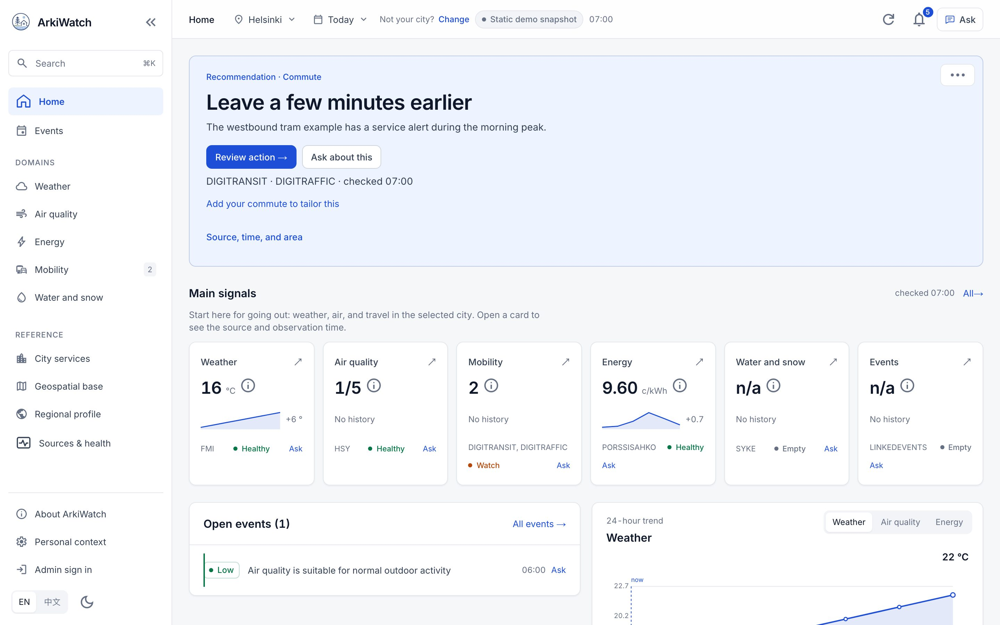
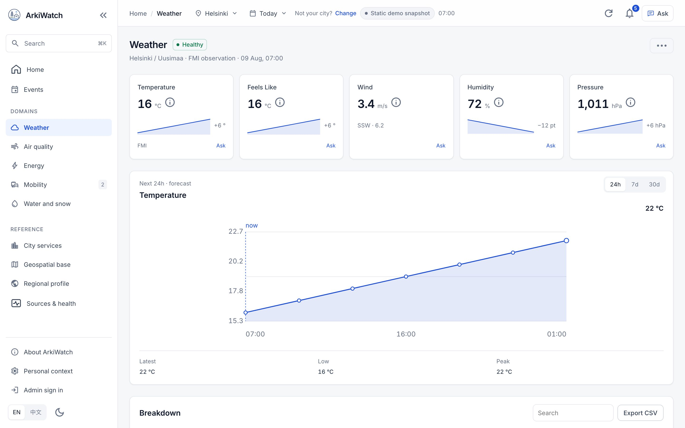
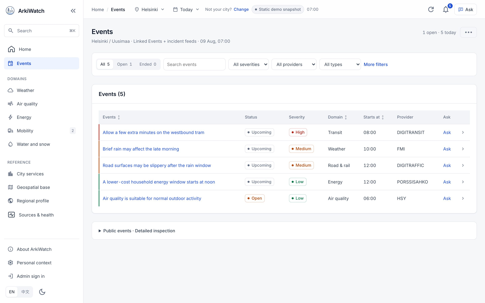
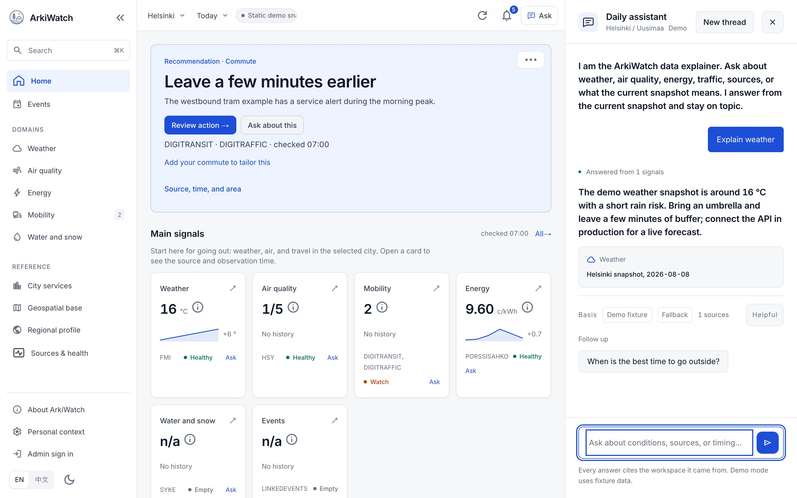
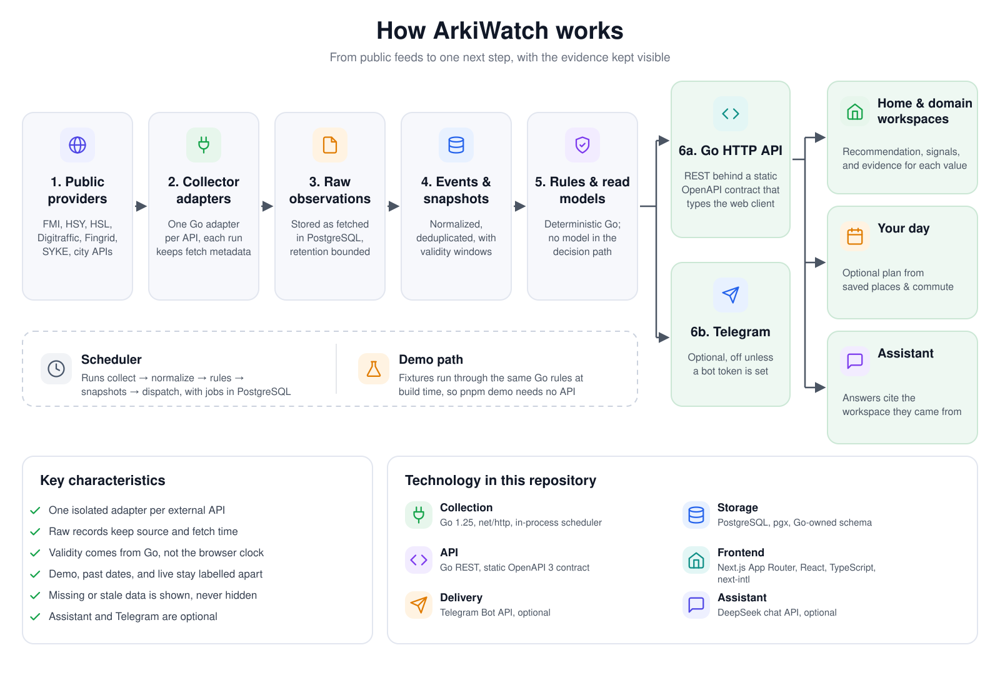

<p align="center">
  
</p>

<h1 align="center">ArkiWatch</h1>

<p align="center">
  A daily dashboard for Finnish public data: weather, air quality, transit, energy prices, and city events.
</p>

<p align="center">
  <a href="https://github.com/rootSunc/ArkiWatch/actions/workflows/ci.yml"></a>
  <a href="LICENSE"></a>
  
  
  
  <a href="docs/data-sources.md"></a>
</p>

<p align="center">
  
</p>

## What it is

ArkiWatch collects open data from Finnish providers (FMI, HSY, HSL, Fingrid,
SYKE and others) and shows what matters for the day ahead. Every reading
shows where it came from, when it was fetched, and which area it covers.

- **Home**: today's recommendation, six signal tiles, open events, and a trend chart.
- **Domain workspaces**: weather, air, energy, mobility, water, events, and
  reference data, each with a table, a chart, and source details.
- **Assistant**: answers questions from the current data and links to the
  workspace it used.
- **Your day**: an optional plan based on saved places and your commute.

The demo is marked as a snapshot, past dates are read only, and missing data
is shown as missing. Helsinki has the most complete coverage.

## Try the demo

You only need Node.js 20+. No database, API keys, or accounts.

```bash
corepack enable && pnpm install && pnpm demo
```

Open [localhost:3000](http://localhost:3000), click **Ask about this** on the
recommendation, and follow the link in the answer.

<table>
  <tr>
    <td width="33%"><br><sub>Domain workspace</sub></td>
    <td width="33%"><br><sub>Events</sub></td>
    <td width="33%"><br><sub>Assistant</sub></td>
  </tr>
</table>

## How it works

<p align="center">
  
</p>

The Go backend collects the data and computes all recommendations. The Next.js
frontend only displays them. The demo is built by running the same Go rules
over fixture data, so it behaves like the live version.

## Coverage

| City | Weather | Air | Transit | Water | City services | Events |
| --- | :---: | :---: | :---: | :---: | :---: | :---: |
| Helsinki | ✓ | ✓ | ✓ | ✓ | ✓ | ✓ |
| Espoo | ✓ | ✓ | ✓ | ✓ | | ✓ |
| Vantaa | ✓ | ✓ | ✓ | ✓ | | |
| Tampere, Turku, Oulu | ✓ | ✓ | | ✓ | | |

Energy and road/rail data are national. A ✓ means the city is supported, not
that a deployment currently has fresh data. Use `/api/health/data-quality` to
check that.

## Docs

| Topic | Document |
| --- | --- |
| Local setup, checks, and secrets | [Development](docs/development.md) |
| Backend design and where logic lives | [Architecture](docs/architecture.md) |
| UI structure and styling rules | [Frontend](docs/frontend.md) |
| Providers, licences, and attribution | [Data sources](docs/data-sources.md) |
| Goals and open questions | [Product scope](docs/product-scope.md) |
| Stored and shared data | [Privacy page](apps/web/src/app/privacy/privacy-page.tsx) (`/privacy` in the app) |

## Status

This is a pre-release. The main features work, but providers, coverage, and the
UI may still change. Bug reports are welcome in
[issues](https://github.com/rootSunc/ArkiWatch/issues/new/choose), and new
Finnish data sources can be suggested with the
[data source template](https://github.com/rootSunc/ArkiWatch/issues/new?template=data_source.yml).

## License

[AGPL-3.0-only](LICENSE), © 2025-2026 Chao Sun (rootSunc). See
[LICENSING.md](LICENSING.md) for hosting, commercial use, and the name and
logo. The data belongs to its providers. Most feeds are CC BY 4.0 and require
[attribution](docs/data-sources.md#attribution).
