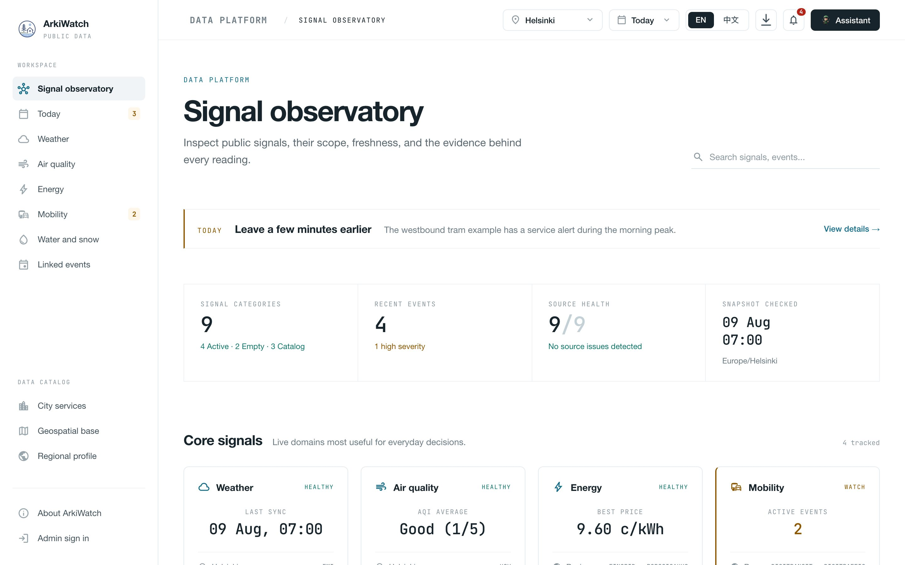
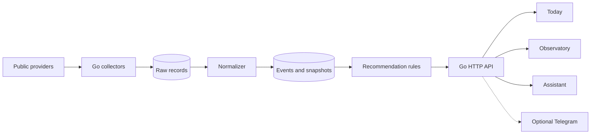

<p align="center">
  
</p>

<h1 align="center">ArkiWatch</h1>

<p align="center">
  <strong>Public data. Practical decisions.</strong><br>
  An open-source daily workspace for Finnish weather, air, mobility, energy, and city signals — with the evidence kept visible.
</p>

<p align="center">
  <a href="https://github.com/rootSunc/ArkiWatch/actions/workflows/ci.yml"></a>
  <a href="LICENSE"></a>
  
  
</p>

<p align="center">
  <a href="#try-it">Try the demo</a> ·
  <a href="#run-the-live-stack">Run locally</a> ·
  <a href="docs/data-sources.md">Data sources</a> ·
  <a href="#contributing">Contributing</a>
</p>

<p align="center">
  <a href="apps/web/public/screenshots/today-workspace-en.jpg">
    
  </a>
</p>

<p align="center"><sub>Helsinki demo snapshot · English UI. The same product is available in 中文.</sub></p>

## Why

Everyday decisions in a Finnish city are split across weather pages, transit alerts, air-quality maps, energy prices, and municipal sites. ArkiWatch pulls those public signals into two workspaces:

- **Today** — one useful next step, a short plan, and the context that matters for the next few hours.
- **Signal observatory** — the same data as inspectable evidence: scope, freshness, source health, and links back to the provider.

Recommendations keep their source, fetch time, validity, and coverage boundary visible. The deterministic demo is labelled as a snapshot and is never presented as a live observation.

Finland is the current product context. Helsinki is the most complete city pack; other packs are honest about what is live, regional, or still planned.

## Features

- **Decision-first Today** — a lead recommendation, glance metrics, and a compact day plan.
- **Inspectable observatory** — weather, air, energy, mobility, water/snow, events, and three catalog workspaces.
- **Provenance in the UI** — source health, timestamps, city/date scope, and evidence before interpretation.
- **Grounded assistant** — answers cite the workspace they came from and can open that evidence.
- **Honest city packs** — Helsinki, Espoo, Vantaa, Tampere, Turku, and Oulu, each with a visible capability map.
- **Historical dates** — browse a past day without treating it as live advice.
- **English and 中文** — the product UI is bilingual.
- **Optional personal context** — saved places, commute profile, and Telegram delivery when you self-host.
- **Zero-credential demo** — no PostgreSQL, API keys, or provider accounts required to evaluate the product.

## Try it

The fastest path is the deterministic Helsinki / Uusimaa demo.

```bash
corepack enable
pnpm install
pnpm demo
```

Open [http://localhost:3000](http://localhost:3000).

1. **Today** — start from the recommendation, then open the plan and glance metrics.
2. **Signal observatory** — check source health, coverage, and evidence.
3. **Assistant** — ask a practical question and follow the citation back to a workspace.
4. **About** — [http://localhost:3000/about](http://localhost:3000/about) has the product story and city matrix.

Connect the API when you want live public feeds. The demo will not pretend fixture data is current.

## See the product

<table>
  <tr>
    <td width="50%" align="center" valign="top">
      <a href="apps/web/public/screenshots/data-platform-overview-en.jpg">
        
      </a><br>
      <strong>Signal observatory</strong><br>
      <sub>Scope, freshness, and evidence at a glance.</sub>
    </td>
    <td width="50%" align="center" valign="top">
      <a href="apps/web/public/screenshots/weather-workspace-en.jpg">
        
      </a><br>
      <strong>Signal workspaces</strong><br>
      <sub>Category detail with source and timestamp on the page.</sub>
    </td>
  </tr>
  <tr>
    <td colspan="2" align="center" valign="top">
      <a href="apps/web/public/screenshots/assistant-chat-en.jpg">
        
      </a><br>
      <strong>Assistant</strong><br>
      <sub>Grounded explanations that stay attached to the current snapshot.</sub>
    </td>
  </tr>
</table>

## Data you can inspect

ArkiWatch is a provider adapter and decision layer, not the authoritative source for any feed. Configured providers include FMI, HSY, Open-Meteo, Digitransit / HSL, Digitraffic, Fingrid, SYKE, Helsinki Service Map, Helsinki Linked Events, and electricity-price APIs. See [docs/data-sources.md](docs/data-sources.md) for boundaries and operational assumptions.

The product keeps these distinctions explicit:

- **Scope** — city, regional, national, and provider-defined observations stay labelled.
- **Freshness** — healthy, stale, empty, failing, inactive, and pending are separate states.
- **Provenance** — recommendations retain source, fetch time, validity, and evidence where available.
- **Demo semantics** — fixtures are labelled as snapshots, never as live data.

### City-pack coverage

`live` means the feed is configured for that city. `regional` follows the provider, not the city picker. `planned` is visible but not claimed as live.

| City | Weather | Air | Transit | Water | City services | Events |
| --- | --- | --- | --- | --- | --- | --- |
| Helsinki | live | live | live | live | live | live |
| Espoo | live | live | live | live | planned | live |
| Vantaa | live | live | live | live | planned | planned |
| Tampere | live | live | planned | live | planned | planned |
| Turku | live | live | planned | live | planned | planned |
| Oulu | live | live | planned | live | planned | planned |

Energy and road/rail are national or provider-defined. Selecting a city does not imply a city-specific observation. Tampere, Turku, and Oulu recommendations stay regional-only.

Machine-readable contracts: `GET /api/platform/coverage` and `GET /api/health/data-quality`.

## How it works



Collector adapters isolate each external API. Raw records keep fetch metadata. Normalized products feed both guidance and the inspectable workspaces. The static API contract lives in [`contracts/openapi.json`](contracts/openapi.json) and generates the frontend types.

| Layer | Stack |
| --- | --- |
| Web | Next.js App Router, React, TypeScript, `next-intl` |
| API | Go 1.25, `pgx`, explicit PostgreSQL repositories |
| Data | PostgreSQL, Go-owned idempotent schema lifecycle |
| Jobs | Collectors, normalizer, rules, scheduler, backfill, dispatch |
| Quality | `go vet`, `go test`, Vitest, Playwright, accessibility smoke tests |
| Operations | Docker, health checks, structured logs, request IDs, optional OpenTelemetry |

## Run the live stack

Use this path for real provider data and the full backend.

**Requirements:** Node.js 20+, Corepack / pnpm, Go 1.25+, PostgreSQL.

```bash
corepack enable
pnpm install

cp apps/api/.env.example apps/api/.env
cp apps/web/.env.example apps/web/.env.local

createdb arkiwatch
pnpm run migrate:api
pnpm run bootstrap:api
pnpm dev
```

| Surface | URL |
| --- | --- |
| Web | [http://localhost:3000](http://localhost:3000) |
| About | [http://localhost:3000/about](http://localhost:3000/about) |
| API | [http://localhost:8000/api](http://localhost:8000/api) |
| Health | [http://localhost:8000/api/health](http://localhost:8000/api/health) |

Go commands load `apps/api/.env` when run from the repository root. Do not commit `.env` files, tokens, or personal data. Full local notes: [docs/development.md](docs/development.md). An optional single-VPS recipe lives in [`deploy/`](deploy/README.md).

## Repository

```text
.
├── apps/api            # Go API, collectors, normalizer, scheduler, schema
├── apps/web            # Next.js App Router, workspaces, assistant
├── contracts           # Static OpenAPI contract
├── docs                # Development, data-source, and UI notes
├── deploy              # Optional Docker / VPS recipe
├── .github             # CI, issue templates, pull-request template
└── package.json        # Workspace commands
```

## Development

| Command | Purpose |
| --- | --- |
| `pnpm demo` | Zero-credential deterministic product tour |
| `pnpm dev` | Go API and Next.js together |
| `pnpm run migrate:api` | Idempotent PostgreSQL schema lifecycle |
| `pnpm run bootstrap:api` | Admin, source, rule, and scheduler metadata |
| `pnpm check` | Backend and frontend quality gates |
| `pnpm run test:e2e` | Browser and accessibility smoke tests against the demo |
| `pnpm run contracts:check` | OpenAPI vs generated frontend types |
| `pnpm run contracts:check:live` | Live API responses vs the OpenAPI contract |
| `pnpm run audit:api` | `govulncheck` on the Go module graph |

One-shot live pipeline:

```bash
pnpm run dev:collector -- all
pnpm run dev:normalize -- -hours 24
pnpm run dev:scheduler -- --once
```

Focused checks: `pnpm run test:api`, `pnpm run test:web`, `pnpm run lint:api`, `pnpm run lint:web`, `pnpm run typecheck:web`. Schema or contract changes must update the Go reconciler, `contracts/openapi.json`, generated frontend types, and tests together.

## Contributing

The useful contributions are small and concrete.

- **Use the demo** and [open an issue](https://github.com/rootSunc/ArkiWatch/issues/new/choose) if something is unclear, wrong, or over-claimed.
- **Propose a Finnish public source** with the [data-source template](https://github.com/rootSunc/ArkiWatch/issues/new?template=data_source.yml): license, rate limits, coverage, and the daily decision it would improve.
- **Keep EN and 中文 in sync** for any user-facing copy.
- **Add a collector only with fixtures and tests.** External providers are not part of the test contract.
- **Do not claim nationwide or live coverage** that the city pack and `/api/platform/coverage` do not support.

A typical change should pass `pnpm check` and, when the API contract moves, `pnpm run contracts:check`. UI changes should include a screenshot or a short recording.

## Project status

ArkiWatch is pre-release software. The main product paths and engineering foundations are in place; provider availability, geographic coverage, external API limits, and UI details can change.

Current focus:

- strengthening the six existing city packs without overstating coverage;
- keeping demo, historical, and live semantics visibly separate;
- improving grounded recommendations and evidence presentation;
- accepting community collectors that meet the provenance bar.

## Acknowledgements

Public data comes from the providers above. They remain the authoritative sources; ArkiWatch only adapts, timestamps, and explains what it fetched. Confirm each provider's current terms, attribution rules, and rate limits before deploying a city pack.

## License and privacy

- Licensed under the [GNU Affero General Public License v3.0](LICENSE).
- [PRIVACY.md](PRIVACY.md) describes the data boundary for demo, accounts, and self-hosted deployments.

If the project is useful, a [GitHub star](https://github.com/rootSunc/ArkiWatch) helps other people find it.
