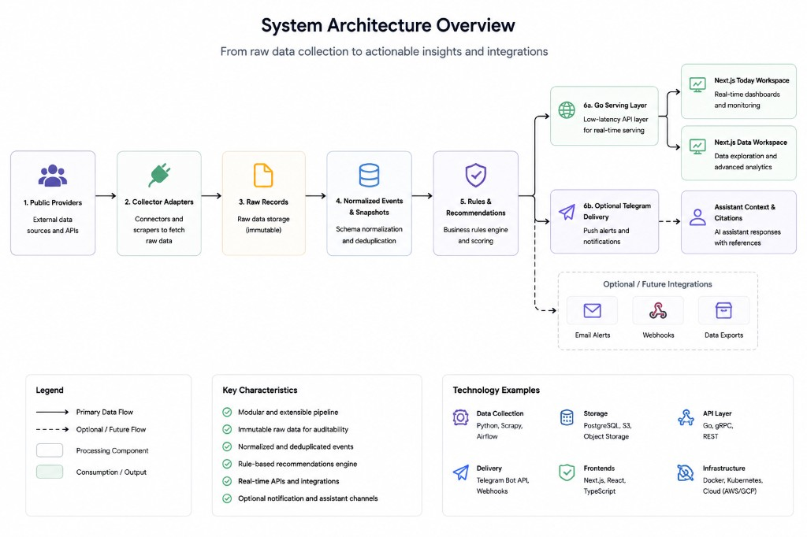

<p align="center">
  
</p>

<h1 align="center">ArkiWatch</h1>

<p align="center">
  <strong>Public data. Practical decisions.</strong><br>
  A daily workspace for Finnish weather, air, mobility, energy, and city signals — with the evidence kept visible.
</p>

<p align="center">
  <a href="https://github.com/rootSunc/ArkiWatch/actions/workflows/ci.yml"></a>
  <a href="LICENSE"></a>
  
  
</p>

<p align="center">
  <a href="#try-the-demo">Try it</a> ·
  <a href="#the-interface">Interface</a> ·
  <a href="#coverage">Coverage</a> ·
  <a href="#architecture">Architecture</a> ·
  <a href="#run-it-yourself">Run it</a> ·
  <a href="docs/README.md">Docs</a>
</p>

<p align="center">
  <a href="apps/web/public/screenshots/data-platform-overview-en.jpg">
    
  </a>
</p>

<p align="center"><sub>Signal observatory · Helsinki demo snapshot · English UI. The same product is available in 中文.</sub></p>

## What it is

Everyday decisions in a Finnish city are scattered across weather pages, transit
alerts, air-quality maps, energy prices, and municipal sites. ArkiWatch gathers
those public signals into two workspaces:

- **Today** gives you one useful next step, a short plan, and the context that
  matters for the next few hours.
- **Signal observatory** is the same data as inspectable evidence: scope,
  freshness, source health, and a link back to the provider.

What holds them together is that nothing appears without its provenance. Every
recommendation keeps its source, fetch time, validity window, and coverage
boundary. Fixture data is labelled a snapshot and never dressed up as live.

Beyond that: a grounded assistant whose answers cite the workspace they came
from, historical dates you can browse without mistaking them for advice, an
honest capability map per city, a bilingual EN / 中文 interface, and optional
personal context — saved places, commute, Telegram — when you self-host.

Finland is the current product context, and Helsinki is the most complete city.

## Try the demo

The demo needs Node.js 20+ and Corepack / pnpm, but no database, API keys,
or provider accounts. Its data and assistant responses use fixtures; map views
can still request external map tiles.

```bash
corepack enable
pnpm install
pnpm demo
```

Open [localhost:3000](http://localhost:3000) and start in **Signal observatory**
to inspect the source scope and freshness. Open **Today** for the recommendation.
Ask the **assistant** a question and follow its citation back to a workspace.
[`/about`](http://localhost:3000/about) has the product story and the city matrix.

The demo will not pretend fixture data is current. Connect the API when you want
live public feeds — see [Run it yourself](#run-it-yourself).

## The interface

<table>
  <tr>
    <td width="50%" align="center" valign="top">
      <a href="apps/web/public/screenshots/data-platform-overview-en.jpg">
        
      </a><br>
      <strong>Signal observatory</strong><br>
      <sub>Scope, freshness, and evidence at a glance.</sub>
    </td>
    <td width="50%" align="center" valign="top">
      <a href="apps/web/public/screenshots/today-workspace-en.jpg">
        
      </a><br>
      <strong>Today</strong><br>
      <sub>One next step, with the evidence behind it.</sub>
    </td>
  </tr>
  <tr>
    <td width="50%" align="center" valign="top">
      <a href="apps/web/public/screenshots/weather-workspace-en.jpg">
        
      </a><br>
      <strong>Signal workspaces</strong><br>
      <sub>Category detail with source and timestamp on the page.</sub>
    </td>
    <td width="50%" align="center" valign="top">
      <a href="apps/web/public/screenshots/assistant-chat-en.jpg">
        
      </a><br>
      <strong>Assistant</strong><br>
      <sub>Every answer carries the snapshot it was drawn from.</sub>
    </td>
  </tr>
</table>

## Coverage

ArkiWatch is a provider adapter and decision layer, not the authoritative source
for any feed. Configured providers include FMI, HSY, Open-Meteo, Digitransit /
HSL, Digitraffic, Fingrid, SYKE, Helsinki Service Map, Helsinki Linked Events,
and electricity-price APIs. [docs/data-sources.md](docs/data-sources.md) covers
boundaries and operational assumptions.

The table describes adapter capabilities, not current service health. `supported` means an adapter exists for that city; it does not establish
that a deployment has credentials, a successful fetch, or fresh data. `planned`
means unsupported today. Check collector status, returned readings, and timestamps in the running instance.

| City | Weather | Air | Transit | Water | City services | Events |
| --- | --- | --- | --- | --- | --- | --- |
| Helsinki | supported | supported | supported | supported | supported | supported |
| Espoo | supported | supported | supported | supported | planned | supported |
| Vantaa | supported | supported | supported | supported | planned | planned |
| Tampere | supported | supported | planned | supported | planned | planned |
| Turku | supported | supported | planned | supported | planned | planned |
| Oulu | supported | supported | planned | supported | planned | planned |

Energy and road/rail are national or provider-defined, so picking a city does
not imply a city-specific observation, and Tampere, Turku, and Oulu
recommendations stay regional-only. The machine-readable version of this table
is `GET /api/platform/coverage`, alongside `GET /api/health/data-quality`.

## Architecture

<p align="center">
  <a href="docs/architecture-overview.jpg">
    
  </a>
</p>

Each external API is isolated behind a collector adapter. Raw records keep their
fetch metadata, and the normalized products feed both the guidance and the
inspectable workspaces. [`contracts/openapi.json`](contracts/openapi.json) is the
static API contract, and it generates the frontend types.

| Layer | Stack |
| --- | --- |
| Web | Next.js App Router, React, TypeScript, `next-intl` |
| API | Go 1.25, `pgx`, explicit PostgreSQL repositories |
| Data | PostgreSQL, Go-owned idempotent schema lifecycle |
| Jobs | Collectors, normalizer, rules, scheduler, backfill, dispatch |
| Quality | `go vet`, `go test`, Vitest, Playwright, accessibility smoke tests |
| Operations | Docker, health checks, structured logs, request IDs, source-health metrics |

Source layout: `apps/api` holds the Go API, collectors, normalizer, scheduler and
schema; `apps/web` the Next.js workspaces and assistant; then `contracts`,
`docs`, and `deploy`.

## Run it yourself

Follow [Development](docs/development.md) for prerequisites, environment setup,
database initialization, collection, and checks. Start with the public data path;
configure personal accounts, Telegram, and the model-backed assistant only when
you need them. [Deployment](deploy/README.md) covers the optional single-VPS recipe.

Go owns recommendations, validity, source health, and energy calculations;
Next.js handles presentation and session transport. See the
[business boundary](docs/go-business-boundary.md) before changing these rules.

The [documentation index](docs/README.md) separates product, contributor, and
operator reading paths. [Public and private records](docs/publication-boundary.md)
explains which examples belong in Git and which instance values stay private.

## Status

Pre-release. The main product paths are implemented;
provider availability, geographic coverage, external API limits, and UI details
can still change. See [Product scope](docs/product-scope.md) for the assumptions still to validate
and recommended completion criteria. Implemented features and passing tests
alone do not establish user value or deployment readiness.

If something is unclear, wrong, or over-claimed,
[open an issue](https://github.com/rootSunc/ArkiWatch/issues/new/choose). A new
Finnish public source is welcome via the
[data-source template](https://github.com/rootSunc/ArkiWatch/issues/new?template=data_source.yml)
— license, rate limits, coverage, and the daily decision it would improve.
Collectors need fixtures and tests; user-facing copy needs both EN and 中文.

## License

[AGPL-3.0-only](LICENSE). [PRIVACY.md](PRIVACY.md) describes the data boundary
for demo, accounts, and self-hosted deployments.

Public data belongs to the providers listed above; ArkiWatch only adapts,
timestamps, and explains what it fetched. Most feeds are CC BY 4.0 and need
crediting — [docs/data-sources.md](docs/data-sources.md) lists each provider's
licence, access requirement, and attribution string. Confirm those terms are
still current before deploying a city pack.
