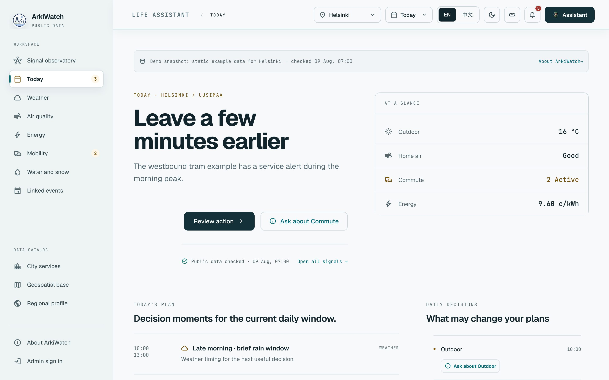
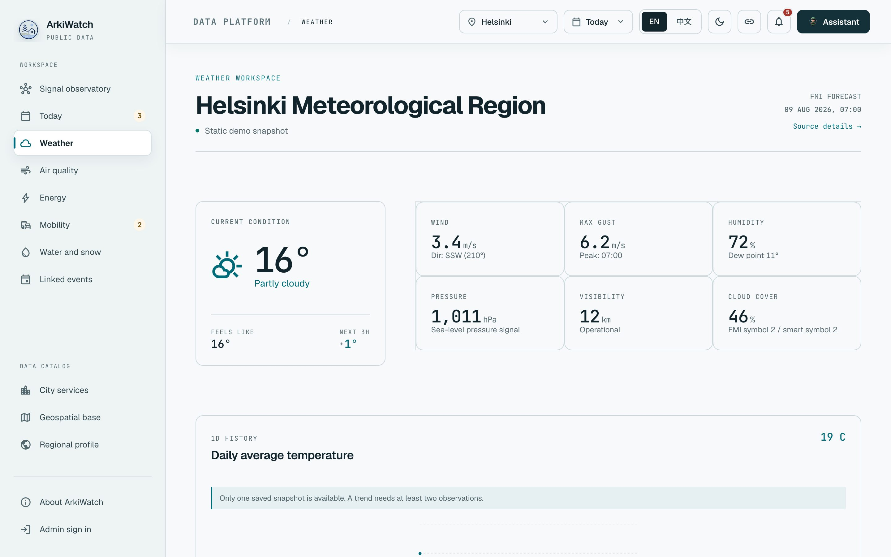
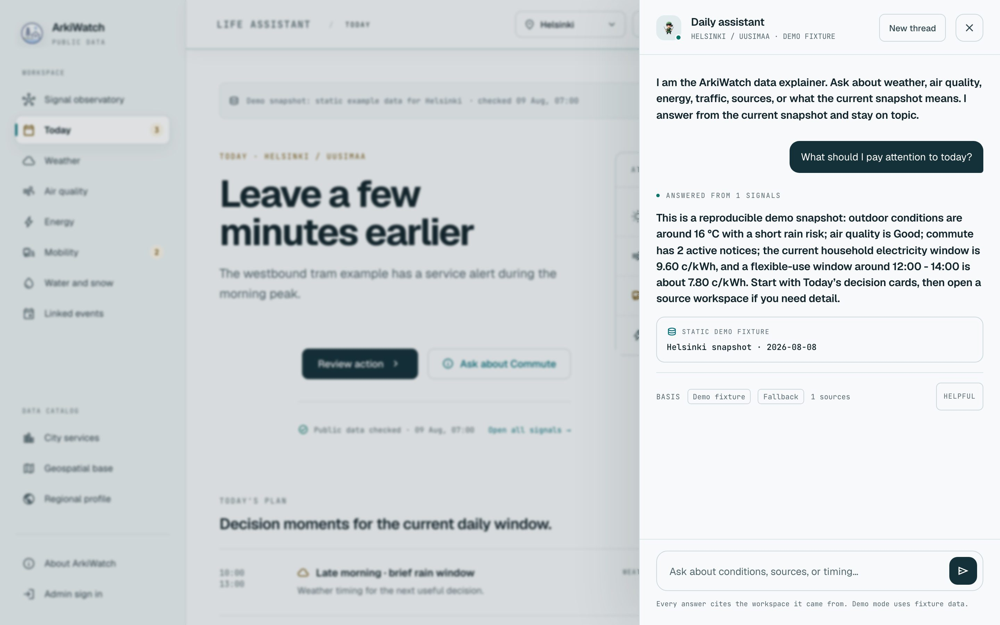
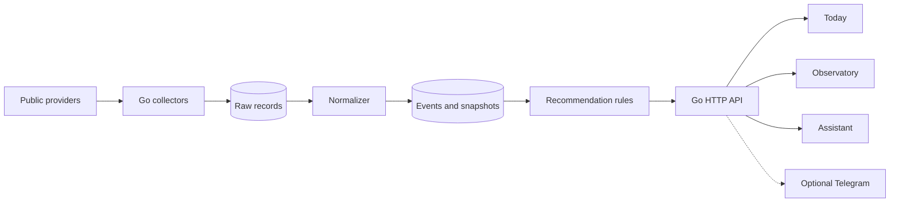

<p align="center">
  
</p>

<h1 align="center">ArkiWatch</h1>

<p align="center">
  <strong>Public data. Practical decisions.</strong><br>
  A daily workspace for Finnish weather, air, mobility, energy, and city signals — with the evidence kept visible.
</p>

<p align="center">
  <a href="https://github.com/rootSunc/ArkiWatch/actions/workflows/ci.yml"></a>
  <a href="LICENSE"></a>
  
  
</p>

<p align="center">
  <a href="#try-it-in-one-command">Try it</a> ·
  <a href="#the-interface">Interface</a> ·
  <a href="#coverage">Coverage</a> ·
  <a href="#architecture">Architecture</a> ·
  <a href="#run-it-yourself">Run it</a>
</p>

<p align="center">
  <a href="apps/web/public/screenshots/today-workspace-en.jpg">
    
  </a>
</p>

<p align="center"><sub>Helsinki demo snapshot · English UI. The same product is available in 中文.</sub></p>

## What it is

Everyday decisions in a Finnish city are scattered across weather pages, transit
alerts, air-quality maps, energy prices, and municipal sites. ArkiWatch gathers
those public signals into two workspaces:

- **Today** gives you one useful next step, a short plan, and the context that
  matters for the next few hours.
- **Signal observatory** is the same data as inspectable evidence: scope,
  freshness, source health, and a link back to the provider.

What holds them together is that nothing appears without its provenance. Every
recommendation keeps its source, fetch time, validity window, and coverage
boundary. Fixture data is labelled a snapshot and never dressed up as live.

Beyond that: a grounded assistant whose answers cite the workspace they came
from, historical dates you can browse without mistaking them for advice, an
honest capability map per city, a bilingual EN / 中文 interface, and optional
personal context — saved places, commute, Telegram — when you self-host.

Finland is the current product context, and Helsinki is the most complete city.

## Try it in one command

The demo needs no database, API keys, or provider accounts.

```bash
corepack enable
pnpm install
pnpm demo
```

Open [localhost:3000](http://localhost:3000) and start from the recommendation
on **Today**, then open **Signal observatory** to check where it came from. Ask
the **assistant** a question and follow its citation back to a workspace.
[`/about`](http://localhost:3000/about) has the product story and the city matrix.

The demo will not pretend fixture data is current. Connect the API when you want
live public feeds — see [Run it yourself](#run-it-yourself).

## The interface

<table>
  <tr>
    <td width="50%" align="center" valign="top">
      <a href="apps/web/public/screenshots/data-platform-overview-en.jpg">
        
      </a><br>
      <strong>Signal observatory</strong><br>
      <sub>Scope, freshness, and evidence at a glance.</sub>
    </td>
    <td width="50%" align="center" valign="top">
      <a href="apps/web/public/screenshots/weather-workspace-en.jpg">
        
      </a><br>
      <strong>Signal workspaces</strong><br>
      <sub>Category detail with source and timestamp on the page.</sub>
    </td>
  </tr>
  <tr>
    <td colspan="2" align="center" valign="top">
      <a href="apps/web/public/screenshots/assistant-chat-en.jpg">
        
      </a><br>
      <strong>Assistant</strong><br>
      <sub>Every answer carries the snapshot it was drawn from.</sub>
    </td>
  </tr>
</table>

## Coverage

ArkiWatch is a provider adapter and decision layer, not the authoritative source
for any feed. Configured providers include FMI, HSY, Open-Meteo, Digitransit /
HSL, Digitraffic, Fingrid, SYKE, Helsinki Service Map, Helsinki Linked Events,
and electricity-price APIs. [docs/data-sources.md](docs/data-sources.md) covers
boundaries and operational assumptions.

`live` means the feed is configured for that city. `regional` follows the
provider, not the city picker. `planned` is visible but not claimed as live.

| City | Weather | Air | Transit | Water | City services | Events |
| --- | --- | --- | --- | --- | --- | --- |
| Helsinki | live | live | live | live | live | live |
| Espoo | live | live | live | live | planned | live |
| Vantaa | live | live | live | live | planned | planned |
| Tampere | live | live | planned | live | planned | planned |
| Turku | live | live | planned | live | planned | planned |
| Oulu | live | live | planned | live | planned | planned |

Energy and road/rail are national or provider-defined, so picking a city does
not imply a city-specific observation, and Tampere, Turku, and Oulu
recommendations stay regional-only. The machine-readable version of this table
is `GET /api/platform/coverage`, alongside `GET /api/health/data-quality`.

## Architecture



Each external API is isolated behind a collector adapter. Raw records keep their
fetch metadata, and the normalized products feed both the guidance and the
inspectable workspaces. [`contracts/openapi.json`](contracts/openapi.json) is the
static API contract, and it generates the frontend types.

| Layer | Stack |
| --- | --- |
| Web | Next.js App Router, React, TypeScript, `next-intl` |
| API | Go 1.25, `pgx`, explicit PostgreSQL repositories |
| Data | PostgreSQL, Go-owned idempotent schema lifecycle |
| Jobs | Collectors, normalizer, rules, scheduler, backfill, dispatch |
| Quality | `go vet`, `go test`, Vitest, Playwright, accessibility smoke tests |
| Operations | Docker, health checks, structured logs, request IDs, optional OpenTelemetry |

Source layout: `apps/api` holds the Go API, collectors, normalizer, scheduler and
schema; `apps/web` the Next.js workspaces and assistant; then `contracts`,
`docs`, and `deploy`.

## Run it yourself

For real provider data and the full backend you need Node.js 20+, Corepack /
pnpm, Go 1.25+, and PostgreSQL.

```bash
corepack enable
pnpm install

cp apps/api/.env.example apps/api/.env
cp apps/web/.env.example apps/web/.env.local

createdb arkiwatch
pnpm run migrate:api
pnpm run bootstrap:api
pnpm dev
```

That serves the web app on [:3000](http://localhost:3000) and the API on
[:8000/api](http://localhost:8000/api), with health at
[`/api/health`](http://localhost:8000/api/health). Go commands load
`apps/api/.env` when run from the repository root. Never commit `.env` files,
tokens, or personal data.

To pull data once, by hand:

```bash
pnpm run dev:collector -- all
pnpm run dev:normalize -- -hours 24
pnpm run dev:scheduler -- --once
```

| Command | Purpose |
| --- | --- |
| `pnpm demo` | Zero-credential deterministic product tour |
| `pnpm dev` | Go API and Next.js together |
| `pnpm check` | Backend and frontend quality gates |
| `pnpm run test:e2e` | Browser and accessibility smoke tests |
| `pnpm run contracts:check` | OpenAPI vs generated frontend types |
| `pnpm run audit:api` | `govulncheck` on the Go module graph |

Schema or contract changes move together: the Go reconciler,
`contracts/openapi.json`, the generated frontend types, and the tests. Full local
notes are in [docs/development.md](docs/development.md), and an optional
single-VPS recipe in [`deploy/`](deploy/README.md).

## Status

Pre-release. The main product paths and engineering foundations are in place;
provider availability, geographic coverage, external API limits, and UI details
can still change. Current focus is strengthening the six city packs without
overstating them, keeping demo / historical / live semantics visibly separate,
and improving how evidence is presented.

If something is unclear, wrong, or over-claimed,
[open an issue](https://github.com/rootSunc/ArkiWatch/issues/new/choose). A new
Finnish public source is welcome via the
[data-source template](https://github.com/rootSunc/ArkiWatch/issues/new?template=data_source.yml)
— license, rate limits, coverage, and the daily decision it would improve.
Collectors need fixtures and tests; user-facing copy needs both EN and 中文.

## License

[AGPL-3.0-only](LICENSE). [PRIVACY.md](PRIVACY.md) describes the data boundary
for demo, accounts, and self-hosted deployments.

Public data belongs to the providers listed above; ArkiWatch only adapts,
timestamps, and explains what it fetched. Confirm each provider's current terms,
attribution rules, and rate limits before deploying a city pack.
