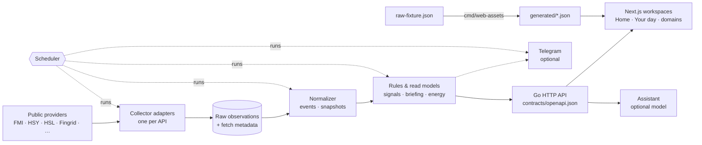
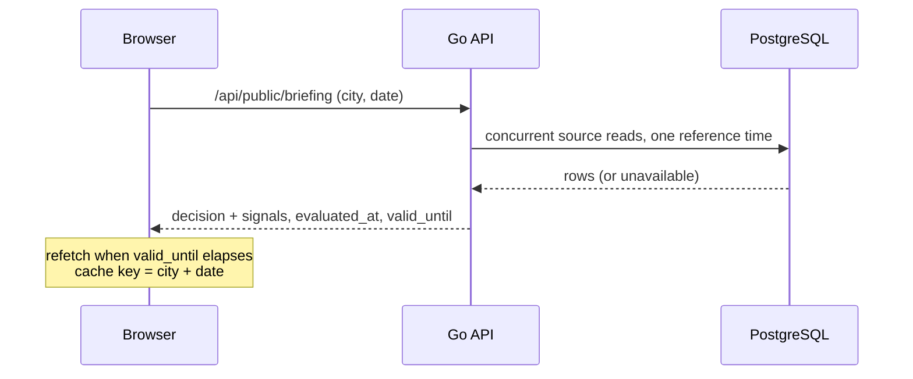

# Architecture

The Go backend makes all decisions and Next.js displays them. Each decision
records its source, fetch time, validity window, and scope.

The demo path (bottom) runs the same Go rules at build time and commits the
output, so `pnpm demo` needs no API, database, or keys.

## Who owns what

| Concern | Owner |
| --- | --- |
| Collection, normalization, retention | Go: `collectors`, `collectorservice`, `normalizer` |
| Advisories, ranking, relevance, noise filtering | Go: `internal/signals` |
| Briefing: event merge, action validity, plan dedup, source health | Go: `internal/briefing` |
| Recommendations and public rules | Go: `rules`, `publicrules` |
| Energy cost (min/max/avg, `cost_status`) | Go: `internal/energy` |
| Detail states (weather, air, transit, road/rail) | Go: domain packages + shared `detailstate`; `readmodel` for old snapshots |
| City catalog and capabilities | Go: `internal/platform/coverage.go` |
| Labels, formatting, charts, layout, URL state, search, read state | Next.js |
| Cookies, CSRF, timeouts, session transport | Next.js route handlers (`apps/web/src/app/api`) |

Don't move presentation into Go, and don't recompute a Go decision in the
browser. The backend is Go only (`pnpm run architecture:check` rejects Python).

## Public read path

`GET /api/public/briefing?city=&date=` returns one bundle for Home:
`decision` (events, timeline, plans, action eligibility, source health),
`signals` (weather, air, transit, road/rail, energy), and `coverage_region`.

Rules that must hold:

- `valid_until` comes from Go; the browser never uses its own clock to decide
  if an action is still valid. Expired or failed caches show no advice.
- Unavailable sources return their unavailable read model; database failures
  return HTTP 503, never healthy-but-empty data.
- Historical dates are read-only and never gain live actions.
- Intervals are evaluated against the response's reference time; malformed
  or reversed intervals are excluded.
- Advisory IDs include city and source time (plus a content hash for distinct warnings).

Older stored snapshots are enriched on read (`readmodel`,
`energy.EnrichHistoricalCosts`) using their recorded time and usage. Stored rows
are never rewritten; missing values stay missing.

## Personal path

`GET/POST /api/me/context` aggregates the signed-in user's locations,
preferences, commute profiles, and channels, and dispatches writes to the
existing resource handlers with their ownership checks. The Next.js
`/api/personal/context` route only forwards it.

## Scheduler and history

One process, jobs persisted in PostgreSQL: `COLLECTOR`, `PIPELINE_NORMALIZE`,
`PIPELINE_SNAPSHOTS`, `RULES`, `DISPATCH`, `BACKFILL`, `PLATFORM_REFRESH`.

Picking a past date reads stored data; it never requests an upstream archive.
Initial backfill is off by default (`INITIAL_BACKFILL_ENABLED=false`). When on:

1. The [planner](../apps/api/internal/database/backfill_planner.go) queues
   bounded windows per range-capable source, using
   [source policy](../apps/api/internal/sourcepolicy/policy.go).
2. The scheduler claims up to `BACKFILL_MAX_DUE_WINDOWS` per tick, with lock
   expiry and retries ([backfill.go](../apps/api/internal/database/backfill.go)).
3. Collected windows are normalized and rolled up into the parent job.

Limits: "covered" means one observation per source per local day, not a
complete archive. Providers may not retain the dates requested. Backfill never
triggers notifications. Missing history stays visibly missing.

## Contracts and generated assets

| Source of truth | Generated | Command |
| --- | --- | --- |
| `contracts/openapi.json` | `apps/web/src/lib/api-contract.ts` | `pnpm run contracts:generate` |
| Go rules + `demo/raw-fixture.json` | `data-platform/generated/*.json` | `pnpm run domain:generate` |

`pnpm run contracts:check` fails on drift for both. After changing a Go decision,
coverage, or a fixture, run both generators and commit the output.
`pnpm run contracts:check:live` compares a running API against the contract.

## Binaries

`apps/api/cmd`: `server`, `scheduler`, `collector`, `normalize`, `migrate`,
`bootstrap`, `web-assets`. The schema reconciler is idempotent; `migrate` then
`bootstrap` is safe to rerun. Go config reads the process environment only; the
`pnpm` wrappers load `apps/api/.env` for you.
