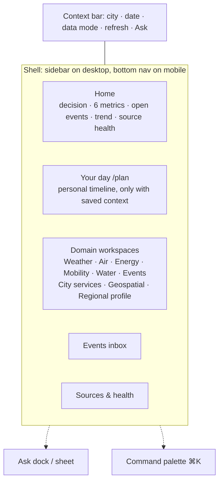

# Frontend

Next.js App Router, React, TypeScript, `next-intl` (EN / 中文). Data comes from
Go read models; the browser formats and lays it out, it doesn't decide.

## Surfaces



Every domain page has the same skeleton: `PageHeader` → KPI row → chart →
sortable `DataTable` → inspection disclosure (maps, pipelines) → source footer.
Scope (city, date, view) lives in the URL.

## Behavior rules

- **Evidence:** values open `EvidencePopover`: provider, location,
  timestamp, method, licence, link. Unknown metadata reads "unrecorded".
- **Failures:** failed requests or expired briefings mark tiles
  Failed/Stale and hide the reading. Empty domains stay visible with a state.
- **Charts:** with fewer than 3 finite samples, a notice shows the count instead.
  X position is elapsed time, not array index. 7/30-day filters use real
  calendar dates and skip missing days.
- **Events:** one filter bar (All/Open/Ended, type, search, domain, provider,
  severity). "Open" = active at the viewed reference time. CSV export follows
  the filters.
- **Sources & health:** the last success survives a failed latest run. Day buckets
  use Europe/Helsinki. Historical views ignore later runs.
- **Ask:** a resizable non-modal dock at 1280px and wider, otherwise a modal
  sheet with a focus trap. Changing city/date resets the conversation scope.
- **Keyboard:** ⌘/Ctrl+K opens the palette; `g h` / `g e` / `g s` → Home / Events / Sources.
- **Mobile:** no horizontal scroll at 320px in either language. City/date open
  in a bottom sheet.

## Styling

| Rule | Where |
| --- | --- |
| All literal colors (accent `#1D4ED8`, light + dark) | `src/app/tokens.css` only |
| Layer order `reset, tokens, base, components, features, overrides` | declared in `tokens.css` |
| Shared primitives (`Card`, `MetricTile`, `DataTable`, `ChartFrame`, `Drawer`, …) | `src/features/shared/ui/console.tsx` + `console.module.css` |
| Shell, chart, plan, inbox, skeleton, inspection sheets | `src/features/data-platform/styles/` |

Fonts: Inter for UI (CJK fallback, tabular numbers), JetBrains Mono for code.
Radii: 8px frames/controls, 4px filters. Status colors always come with words.

Declare `@layer` inside each stylesheet. The pinned Next CSS loader treats
`@import "x.css" layer(y)` as a media query. `pnpm --filter @arkiwatch/web check`
enforces: colors only in tokens, `!important` only in overrides, total CSS
under 6,000 lines, no legacy i18n keys.

## Checking a UI change

```bash
pnpm --filter @arkiwatch/web check
pnpm run test:e2e
```

For CSS refactors, run `e2e/tools/style-snapshot.mjs` before and after, then
`style-diff.mjs`: a pure refactor should produce an empty diff. README screenshots come
from `e2e/tools/screenshots.mjs` against a demo build.
